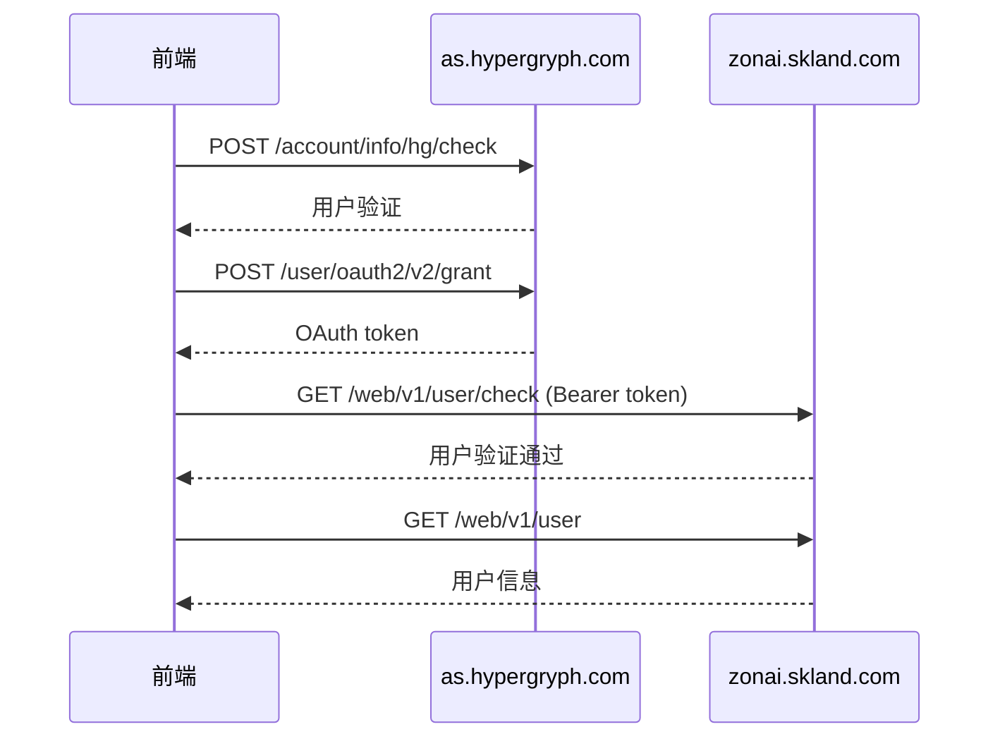
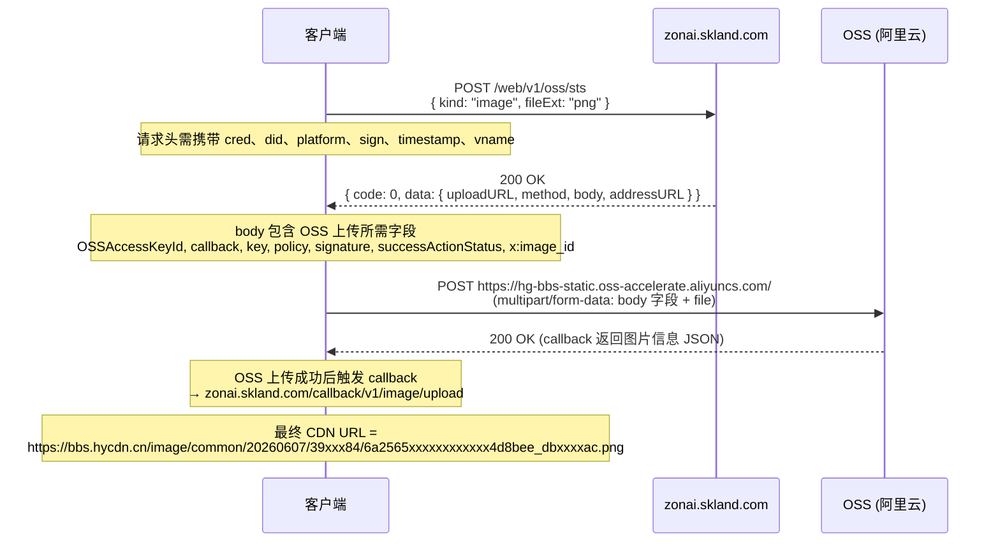
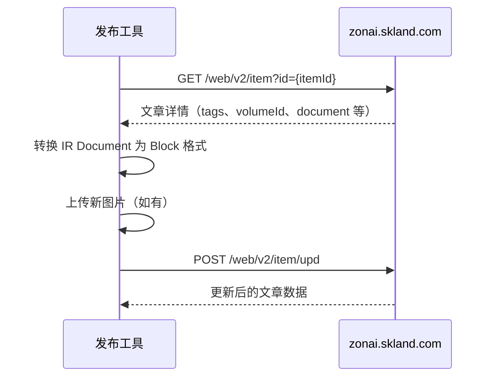

# 森空岛（skland.com）文章格式与 API 文档

> 本文档详细记录了森空岛图文编辑器的数据结构、API 接口和图片上传流程，用于指导森空岛发布器的实现。

---

## 目录

- [森空岛（skland.com）文章格式与 API 文档](#森空岛sklandcom文章格式与-api-文档)
  - [目录](#目录)
  - [1. API 基础](#1-api-基础)
    - [前端框架](#前端框架)
  - [2. 认证方式](#2-认证方式)
    - [Token 存储](#token-存储)
    - [认证流程](#认证流程)
    - [API 请求示例](#api-请求示例)
    - [Cookie](#cookie)
  - [3. 草稿存储机制](#3-草稿存储机制)
    - [Key 格式](#key-格式)
    - [草稿列表格式](#草稿列表格式)
    - [草稿 ID](#草稿-id)
  - [4. Draft 顶层数据结构](#4-draft-顶层数据结构)
    - [完整的 Draft JSON 结构](#完整的-draft-json-结构)
  - [5. 文档元素（document）](#5-文档元素document)
    - [5.1 标题（header）](#51-标题header)
    - [5.2 正文段落（paragraph）](#52-正文段落paragraph)
    - [5.3 引用块（quote）](#53-引用块quote)
    - [5.4 有序列表（ordered-list）](#54-有序列表ordered-list)
    - [5.5 无序列表（unordered-list）](#55-无序列表unordered-list)
    - [5.6 分隔线（dividing-line）](#56-分隔线dividing-line)
    - [5.7 图片区域（image-wrapper）](#57-图片区域image-wrapper)
    - [5.8 内嵌B站视频（external-video）](#58-内嵌b站视频external-video)
    - [5.9 表情（emoji）](#59-表情emoji)
    - [5.10 贴纸（sticker）](#510-贴纸sticker)
    - [5.11 @提及（mention）](#511-提及mention)
    - [5.12 超链接（link）](#512-超链接link)
  - [6. Model 元数据字段详解](#6-model-元数据字段详解)
    - [字段说明](#字段说明)
    - [Tag 对象完整结构](#tag-对象完整结构)
  - [7. 图片上传流程（基于实际抓包）](#7-图片上传流程基于实际抓包)
    - [完整时序图](#完整时序图)
    - [Step 1: 获取 OSS STS 凭证](#step-1-获取-oss-sts-凭证)
    - [Step 2: 上传文件到 OSS（FormData + POST）](#step-2-上传文件到-ossformdata--post)
    - [Step 3: 引用图片](#step-3-引用图片)
    - [图片 CDN URL 格式](#图片-cdn-url-格式)
    - [与源码对照](#与源码对照)
    - [安全/签名注意事项](#安全签名注意事项)
      - [Sign 算法（已验证 ✅）](#sign-算法已验证-)
      - [完整示例（已验证通过 ✅）](#完整示例已验证通过-)
    - [文档部分元素类型概览](#文档部分元素类型概览)
  - [8. 编辑已发布文章 API](#8-编辑已发布文章-api)
    - [8.1 获取文章详情](#81-获取文章详情)
    - [8.2 更新文章](#82-更新文章)
    - [8.3 Block 格式详解（与草稿的 document 不同）](#83-block-格式详解与草稿的-document-不同)
      - [Text Block（文本块）](#text-block文本块)
      - [Image Block（图片块）](#image-block图片块)
      - [HorizontalLine Block（分隔线）](#horizontalline-block分隔线)
    - [8.4 编辑流程](#84-编辑流程)
    - [8.5 已发布文章列表](#85-已发布文章列表)
  - [参考资料](#参考资料)

---

## 1. API 基础

| 项目 | 值 |
|------|-----|
| **API Base** | `https://zonai.skland.com` |
| **前端 CDN** | `https://bbs.hycdn.cn/skland-fe-static/skland-bbs/` |
| **主 JS Bundle** | `main.a67220ef.js` |
| **编辑器 JS 模块** | `5544.1a8c0020.js`（article editor chunk） |
| **请求头格式** | `Authorization: Bearer <token>` |
| **内容类型** | `application/json`（大多数 API） |

### 前端框架

- 使用 React（SPA 架构）
- 基于 Webpack 的代码分割
- 版本: `skland-bbs v0.1.9`
- 运行时配置: `window.__CHIMERA_CONFIG__`

```json
{
  "name": "skland-bbs",
  "version": "0.1.9",
  "environment": "production",
  "pathname": "/editor/article"
}
```

---

## 2. 认证方式

### Token 存储

```javascript
// localStorage 认证相关 Key
SK_TOKEN_CACHE_KEY   // 认证 Token（Bearer token）
SK_OAUTH_CRED_KEY    // OAuth 凭据
HG_INFO_KEY          // 用户基本信息
hg_sdk_device_id     // 设备 ID
smidV2               // 设备指纹
```

### 认证流程



### API 请求示例

```http
GET https://zonai.skland.com/web/v1/user
Authorization: Bearer <SK_TOKEN_CACHE_KEY>
```

### Cookie

- `SK_TOKEN` — 可能也通过 Cookie 传递认证

---

## 3. 草稿存储机制

森空岛使用 **localStorage** 保存草稿，**不通过 API 调用保存草稿**。

### Key 格式

| Key | 格式 | 说明 |
|-----|------|------|
| 草稿列表 | `editor_draft_list_{userId}` | JSON 数组，包含所有草稿摘要 |
| 草稿内容 | `editor_draft_{userId}_{draftId}` | 完整草稿数据（含 metadata + 正文） |

### 草稿列表格式

```json
[
  {
    "draftId": "lMlGxxxxxxxxmznP",
    "updateTime": 17808xxxxxx122,
    "title": "文章标题",
    "cover": "https://bbs.hycdn.cn/image/common/20260607/39xxx84/6a255fxxxxxxxxxxxx92eb2d_6axxxx52.webp",
    "viewKind": 3
  }
]
```

### 草稿 ID

草稿 ID（如 `lMlGxxxxxxxxmznP`）只存在于 URL 参数 `?draftId=` 中，用于区分不同的草稿。编辑器加载页面时从 URL 读取 draftId，然后从 localStorage 中读取对应内容。

---

## 4. Draft 顶层数据结构

```typescript
interface DraftData {
  version: 2;           // 草稿格式版本（目前固定为 2）
  model: ArticleModel;  // 文章元数据
  document: DocumentElement[];  // 正文内容（元素数组）
}
```

### 完整的 Draft JSON 结构

```json
{
  "version": 2,
  "model": { ... },
  "document": [ ... ]
}
```

---

## 5. 文档元素（document）

每个元素都有以下公共字段：

| 字段 | 类型 | 说明 |
|------|------|------|
| `elementId` | string | 唯一标识（编辑器自动生成，发布时可保留或忽略） |
| `type` | string | 元素类型，见下方各节 |
| `children` | array | 子元素/子节点 |

### 5.1 标题（header）

```json
{
  "elementId": "uIlCJq8UsXyO",
  "type": "header",
  "level": 1,
  "children": [
    { "text": "一级标题" },
    { "text": "加粗", "bold": true },
    { "text": "斜体", "italic": true },
    { "text": "粗斜体", "italic": true, "bold": true },
    { "text": "下划线", "underline": true },
    { "text": "删除线", "del": true }
  ]
}
```

**说明：**
- `level` 取值范围：`1`、`2`、`3`
- 标题支持内联样式（粗体、斜体、下划线、删除线）
- 标题不支持文字颜色（与 paragraph 不同）

### 5.2 正文段落（paragraph）

```json
{
  "elementId": "bCvdfB3e5YY9",
  "type": "paragraph",
  "children": [
    { "text": "普通文本 " },
    { "text": "粗体", "bold": true },
    { "text": " " },
    { "text": "斜体", "italic": true },
    { "text": " " },
    { "text": "下划线", "underline": true },
    { "text": " " },
    { "text": "删除线", "del": true }
  ]
}
```

**可选字段：**

| 字段 | 类型 | 说明 |
|------|------|------|
| `alignment` | number | 对齐方式：`1`=左对齐（默认）、`2`=居中、`3`=右对齐 |

**段落支持彩色文字：**

支持色为 `#222222`、`#90C208`、`#46AAFA`、`#FA6E5A`、`#FAB446`、`#826EFF`。
发布器按 Oklab 距离映射到最近的预设色；未设置颜色时保持平台默认样式。

```json
{
  "elementId": "EiM88nFp7tJi",
  "type": "paragraph",
  "children": [
    { "text": "黑色" },
    { "text": "绿色", "color": "#90C208" },
    { "text": "蓝色", "color": "#46AAFA" },
    { "text": "红色", "color": "#FA6E5A" },
    { "text": "橙色", "color": "#FAB446" },
    { "text": "紫色", "color": "#826EFF" }
  ]
}
```

### 5.3 引用块（quote）

```json
{
  "elementId": "yLYi5Qvp8Ual",
  "type": "quote",
  "children": [
    {
      "elementId": "aOlAIcuhD1cG",
      "type": "paragraph",
      "children": [
        { "text": "这是一行引用" }
      ]
    },
    {
      "elementId": "vciOJ1yhHgyK",
      "type": "paragraph",
      "children": [
        { "text": "这个引用和上一行是同一个引用" }
      ]
    }
  ]
}
```

**说明：**
- 引用块内部包含多个 `paragraph` 元素
- 不同引用块之间是独立分隔的
- 引用块不支持嵌套（内部只有 paragraph，不会再有 quote）

### 5.4 有序列表（ordered-list）

```json
{
  "elementId": "8vHjmvSfnebB",
  "type": "ordered-list",
  "children": [
    {
      "elementId": "6aAADnMKsXxV",
      "type": "list-item",
      "children": [
        {
          "elementId": "kXzIS0Z2hOx6",
          "type": "list-item-text",
          "alignment": 1,
          "children": [
            { "text": "有序列表1" }
          ]
        }
      ]
    },
    {
      "elementId": "uJbU1ynfU2DY",
      "type": "list-item",
      "children": [
        {
          "elementId": "WNcUPl7NtYge",
          "type": "list-item-text",
          "alignment": 1,
          "children": [
            { "text": "有序列表2" }
          ]
        },
        {
          "elementId": "X4WIXY9PpExa",
          "type": "ordered-list",
          "children": [
            {
              "elementId": "Q2wWheS87oy9",
              "type": "list-item",
              "children": [
                {
                  "elementId": "bFA9rNStKM4I",
                  "type": "list-item-text",
                  "alignment": 1,
                  "children": [
                    { "text": "有序列表2.1" }
                  ]
                },
                {
                  "elementId": "9GPCXip2Sc8d",
                  "type": "ordered-list",
                  "children": [
                    {
                      "elementId": "46UuOJ0BmES0",
                      "type": "list-item",
                      "children": [
                        {
                          "elementId": "GTAl0l5vJ9XE",
                          "type": "list-item-text",
                          "alignment": 1,
                          "children": [
                            { "text": "有序列表2.1.1" }
                          ]
                        }
                      ]
                    }
                  ]
                }
              ]
            }
          ]
        }
      ]
    }
  ]
}
```

**结构：**
```
ordered-list
  ├── list-item
  │     ├── list-item-text  (对齐方式 alignment)
  │     └── (可选) ordered-list | unordered-list  (嵌套子列表)
  ├── list-item
  │     ├── list-item-text
  │     └── (可选) ordered-list | unordered-list
  └── ...
```

**说明：**
- `list-item` 的 `children` 中第一个子元素是 `list-item-text`，后续可以有嵌套的 `ordered-list` 或 `unordered-list`
- `list-item-text` 支持 `alignment` 字段（与 paragraph 相同）

### 5.5 无序列表（unordered-list）

```json
{
  "elementId": "kv8I634YPx0k",
  "type": "unordered-list",
  "children": [
    {
      "elementId": "9ov13HDPbAcF",
      "type": "list-item",
      "children": [
        {
          "elementId": "ja3u8NvYBCjm",
          "type": "list-item-text",
          "alignment": 1,
          "children": [
            { "text": "无序列表1" }
          ]
        },
        {
          "elementId": "d4TfMHkjR4Kh",
          "type": "unordered-list",
          "children": [
            {
              "elementId": "jZHF7wUC0AuE",
              "type": "list-item",
              "children": [
                {
                  "elementId": "5LwvzZl1DeVd",
                  "type": "list-item-text",
                  "alignment": 1,
                  "children": [
                    { "text": "无序列表2.1" }
                  ]
                },
                {
                  "elementId": "gMdhD5szXgTD",
                  "type": "unordered-list",
                  "children": [
                    {
                      "elementId": "Ji9dICjPcZ8v",
                      "type": "list-item",
                      "children": [
                        {
                          "elementId": "rZSuzQoKY5w9",
                          "type": "list-item-text",
                          "alignment": 1,
                          "children": [
                            { "text": "无序列表2.1.1" }
                          ]
                        }
                      ]
                    }
                  ]
                }
              ]
            }
          ]
        }
      ]
    }
  ]
}
```

**结构：** 与 ordered-list 完全相同，只是外层类型不同。

### 5.6 分隔线（dividing-line）

```json
{
  "kind": "0",
  "elementId": "ZhVJlEoG2vwD",
  "type": "dividing-line",
  "children": [
    { "text": "" }
  ]
}
```

`kind` 取值范围：

| kind | 样式 |
|------|------|
| `"0"` | 默认样式 |
| `"1"` | 样式 1 |
| `"2"` | 样式 2 |
| `"3"` | 样式 3 |
| `"4"` | 样式 4 |

### 5.7 图片区域（image-wrapper）

```json
{
  "elementId": "Ap2V7wG7TjkU",
  "type": "image-wrapper",
  "children": [
    {
      "file": {},
      "elementId": "2eqKNWVqCnce",
      "type": "image",
      "children": [ { "text": "" } ],
      "image": {
        "width": 2160,
        "height": 1080,
        "url": "https://bbs.hycdn.cn/image/common/20260607/39xxx84/6a255fxxxxxxxxxxxx92eb2d_6axxxx52.webp",
        "size": 276494,
        "format": "",
        "id": "6a255fxxxxxxxxxxxx92eb2d"
      }
    },
    {
      "elementId": "Nf6pYX7cT1vt",
      "type": "image-brief",
      "children": [
        { "text": "图片描述" }
      ]
    }
  ]
}
```

**说明：**
- 第一个子元素是 `image` 类型，包含图片元数据（URL、宽高、大小、ID）
- 第二个子元素是 `image-brief` 类型，包含图片描述（可以为空文本）
- `image` 对象中的关键字段：
  - `url` — 图片的 CDN URL
  - `width`、`height` — 原始图片尺寸
  - `size` — 文件大小（字节）
  - `id` — 图片的唯一 ID（用于封面选择）

### 5.8 内嵌B站视频（external-video）

```json
{
  "externalVideo": {
    "kind": "bilibili",
    "id": "BV1xR6nBqELV"
  },
  "elementId": "Dvxvrj0RTkFD",
  "type": "external-video",
  "children": [
    { "text": "" }
  ]
}
```

**说明：**
- `externalVideo.kind` — 视频平台类型（目前仅观察到 `"bilibili"`）
- `externalVideo.id` — 视频 ID（BVID 格式，如 `BV1xR6nBqELV`）

### 5.9 表情（emoji）

```json
{
  "id": "skland_emoji__Wupa_plus1",
  "title": "+1",
  "elementId": "VJYpfCbJUAeL",
  "type": "emoji",
  "children": [ { "text": "" } ]
}
```

`id` 格式：
- `skland_emoji__{category}_{name}` — 自定义表情
- 表情种类：+1, 比心, 爱你, OK, 流汗, ¿, 点赞, 酷, 晕, 红温, 哭哭, 寄, 捏脸, LOVE 等

### 5.10 贴纸（sticker）

```json
{
  "id": "Uppa_Friends-1__生日快乐",
  "title": "生日快乐",
  "elementId": "gE3hhEOHpZRW",
  "type": "sticker",
  "children": [ { "text": "" } ]
}
```

`id` 格式：`Uppa_{packName}__{stickerTitle}`

### 5.11 @提及（mention）

```json
{
  "elementId": "2bNu9eQuYSYj",
  "type": "mention",
  "uid": "402xxxxxxx153",
  "name": "森空岛小助手",
  "children": [
    { "text": "@" }
  ]
}
```

**说明：**
- `uid` — 被提及用户的 ID
- `name` — 被提及用户的显示名称
- `children` 中固定包含 `{ "text": "@" }`

### 5.12 超链接（link）

```json
{
  "content": "BV1xR6nBqELV",
  "link": "https://www.bilibili.com/video/BV1xR6nBqELV",
  "elementId": "28ohGZcX7hPV",
  "type": "link",
  "children": [ { "text": "" } ]
}
```

**说明：**
- `content` — 链接显示文本
- `link` — 目标 URL

---

## 6. Model 元数据字段详解

```json
{
  "viewKind": 3,
  "origin": 1,
  "isAIGCStatementOn": false,
  "downloadEnable": 1,
  "title": "文章标题",
  "tags": [
    { "id": 1452, "name": "寻遗散记版本讨论", ... },
    { "id": 474, "name": "明日方舟", ... }
  ],
  "imageCoverIndex": "6a255fxxxxxxxxxxxx92eb2d",
  "imageList": [],
  "prePublishOn": true,
  "gameId": 1,
  "cateId": 4,
  "collection": {
    "id": "20635xxxxxxxxx50688",
    "title": "1"
  },
  "publishedAtTs": "178xxxx677"
}
```

### 字段说明

| 字段 | 类型 | 说明 | 枚举/取值范围 |
|------|------|------|-------------|
| `viewKind` | number | 文章类型 | `3`=图文 |
| `origin` | number | 原创标记 | `1`=原创 |
| `isAIGCStatementOn` | boolean | AI 生成声明 | |
| `downloadEnable` | number | 允许下载图片 | `1`=允许，`0`=关闭 |
| `title` | string | 文章标题 | 最多 40 字 |
| `tags` | Tag[] | 话题标签 | |
| `imageCoverIndex` | string | 封面图片 ID | 从已上传图片中选一张 |
| `imageList` | array | 额外图片列表 | 通常为空 |
| `prePublishOn` | boolean | 是否为定时发布 | |
| `gameId` | number | 游戏分区 | `1`=明日方舟 |
| `cateId` | number | 子分区 | `4`=攻略（见下方枚举） |
| `collection` | object | 合集 | `{ id, title }` |
| `publishedAtTs` | string | 发布时间戳（定时发布） | |

### Tag 对象完整结构

```json
{
  "id": 1452,
  "name": "寻遗散记版本讨论",
  "description": "参与活动赢奖励~",
  "status": 1,
  "cover": "https://bbs.hycdn.cn/image/2026/06/05/ea8e3ff3xxxxxxxxxxxxxxxx0e421883.png",
  "publishAtTs": 178xxxx774,
  "createdAtTs": 178xxxx011,
  "updatedAtTs": 178xxxx011,
  "kind": 2,
  "bulletinStatus": 0,
  "isGameEvent": false,
  "defaultViewKind": 3
}
```

---

## 7. 图片上传流程（基于实际抓包）

> 以下数据和格式均来自通过浏览器手动上传图片时抓取的 HAR 文件
> （`docs/skland_上传图片_example.har`）。包含两段请求：获取 OSS STS 凭证 → 上传文件到 OSS。

### 完整时序图



### Step 1: 获取 OSS STS 凭证

**请求**

```
POST https://zonai.skland.com/web/v1/oss/sts
```

**请求头（重要！）**

| Header | 值示例 | 说明 |
|--------|--------|------|
| `cred` | `ATxI3T2xxxxxxxxxxxxxxxxxvEsGHi5l` | 认证凭据（来自登录） |
| `did` | `BjCUVaXwmvJuwpqdNk7aExxxxxxxxxxxxxxxxxxxxxxxxxxxxxxxxxxxxxxxxxxxxxxZHpu+HQeATOU/iczy0PA==` | 设备 ID（base64） |
| `platform` | `3` | 平台标识 |
| `sign` | `45efd8e3xxxxxxxxxxxxxxxx501bbfc8` | 请求签名（MD5(HMAC-SHA256)） |
| `timestamp` | `178xxxx689` | 时间戳 |
| `vname` | `1.0.0` | 版本号 |
| `origin` | `https://www.skland.com` | |
| `referer` | `https://www.skland.com/` | |
| `content-type` | `application/json` | |

**请求体**

```json
{
  "kind": "image",
  "fileExt": "png"
}
```

| 参数 | 类型 | 说明 |
|------|------|------|
| `kind` | string | 文件类型：`"image"`（注意是字符串，不是数字） |
| `fileExt` | string | 文件扩展名（小写，如 `"png"`、`"jpg"`、`"webp"`） |

**响应**

```json
{
  "code": 0,
  "message": "成功",
  "data": {
    "uploadURL": "https://hg-bbs-static.oss-accelerate.aliyuncs.com/",
    "method": "POST",
    "body": {
      "OSSAccessKeyId": "LTAI5txxxxxxxxxxxxqJYEVa",
      "callback": "eyJjYWxsYmFja0JvZHkiOiJvYmplY3Q9JHtvYmplY3R9...",
      "key": "image/common/20260607/39xxx84/6a2565xxxxxxxxxxxx4d8bee_dbxxxxac.png",
      "policy": "eyJjb25kaXRpb25zIjpbeyJidWNrZXQiOiJoZy1iYnMtc3RhdGljIn0s...",
      "signature": "desdFMsxxxxxxxxxxxxxxNyKIrg=",
      "successActionStatus": "200",
      "x:image_id": "6a2565xxxxxxxxxxxx4d8bee"
    },
    "addressURL": "https://bbs.hycdn.cn/image/common/20260607/39xxx84/6a2565xxxxxxxxxxxx4d8bee_dbxxxxac.png"
  }
}
```

**响应字段详解：**

| 字段 | 类型 | 说明 |
|------|------|------|
| `data.uploadURL` | string | **OSS 上传端点**：`https://hg-bbs-static.oss-accelerate.aliyuncs.com/`（固定值，不含签名参数） |
| `data.method` | string | HTTP 方法，实际抓包为 **`"POST"`**（不是 PUT） |
| `data.body` | object | **FormData 字段**，每个字段都要 append 到 FormData 中 |
| `data.body.OSSAccessKeyId` | string | 临时 AccessKey（阿里云 STS） |
| `data.body.callback` | string | **Base64 编码的 callback 配置**，OSS 上传成功后回调到 `https://zonai.skland.com/callback/v1/image/upload` |
| `data.body.key` | string | OSS 对象存储的完整路径 |
| `data.body.policy` | string | Base64 编码的 OSS Policy（含过期时间、bucket、key 范围等条件） |
| `data.body.signature` | string | 基于 OSSAccessKeySecret 的签名 |
| `data.body.successActionStatus` | string | 固定值 `"200"` |
| `data.body.x:image_id` | string | **服务端分配的图片唯一 ID** |
| `data.addressURL` | string | **上传成功后的 CDN URL**，可直接用于文章 `image-wrapper` 元素中 |

**callback 字段解码内容（参考）：**

```
callback body:  object={object}&size={size}&imageInfo.height={imageInfo.height}
               &imageInfo.width={imageInfo.width}&imageInfo.format={imageInfo.format}
               &reqId={reqId}&x:image_id={x:image_id}
callback url:   https://zonai.skland.com/callback/v1/image/upload
```

### Step 2: 上传文件到 OSS（FormData + POST）

从 `data.body` 中拿到所有字段后，以 **POST** 方法发送到 `data.uploadURL`：

**实际抓包请求体（multipart/form-data）：**

```
POST https://hg-bbs-static.oss-accelerate.aliyuncs.com/
Content-Type: multipart/form-data; boundary=----WebKitFormBoundaryRf9SIUHcs6Kutvtd

------WebKitFormBoundaryRf9SIUHcs6Kutvtd
Content-Disposition: form-data; name="OSSAccessKeyId"

LTAI5txxxxxxxxxxxxqJYEVa
------WebKitFormBoundaryRf9SIUHcs6Kutvtd
Content-Disposition: form-data; name="callback"

eyJjYWxsYmFja0JvZHkiOiJvYmplY3Q9JHtvYmplY3R9...
------WebKitFormBoundaryRf9SIUHcs6Kutvtd
Content-Disposition: form-data; name="key"

image/common/20260607/39xxx84/6a2565xxxxxxxxxxxx4d8bee_dbxxxxac.png
------WebKitFormBoundaryRf9SIUHcs6Kutvtd
Content-Disposition: form-data; name="policy"

eyJjb25kaXRpb25zIjpbeyJidWNrZXQiOiJoZy1iYnMtc3RhdGljIn0s...
------WebKitFormBoundaryRf9SIUHcs6Kutvtd
Content-Disposition: form-data; name="signature"

desdFMsxxxxxxxxxxxxxxNyKIrg=
------WebKitFormBoundaryRf9SIUHcs6Kutvtd
Content-Disposition: form-data; name="successActionStatus"

200
------WebKitFormBoundaryRf9SIUHcs6Kutvtd
Content-Disposition: form-data; name="x:image_id"

6a2565xxxxxxxxxxxx4d8bee
------WebKitFormBoundaryRf9SIUHcs6Kutvtd
Content-Disposition: form-data; name="file"; filename="221xxxxxxpng"
Content-Type: image/png

<binary data>
------WebKitFormBoundaryRf9SIUHcs6Kutvtd--
```

**对应的 JavaScript 代码：**

```javascript
const formData = new FormData();
// 按顺序 append body 中的所有字段
formData.append("OSSAccessKeyId", body.OSSAccessKeyId);
formData.append("callback", body.callback);
formData.append("key", body.key);
formData.append("policy", body.policy);
formData.append("signature", body.signature);
formData.append("successActionStatus", body.successActionStatus);
formData.append("x:image_id", body["x:image_id"]);
// 最后 append 图片文件
formData.append("file", imageFile, fileName);

const response = await fetch(uploadURL, {
  method: "POST",     // 实际抓包确认是 POST
  body: formData,
  // 注意：不要手动设置 Content-Type，让浏览器自动生成 multipart boundary
});
```

**说明：**
- 使用 `POST` 方法（不是 PUT），上传到 OSS 根路径
- 字段**顺序不重要**，但 `file` 是最后一个字段
- OSS 上传成功后通过 **callback 机制** 通知 `zonai.skland.com/callback/v1/image/upload`
- 回调中返回图片的宽、高、格式等信息
- OSS 响应状态码 200 + Content-Type `application/json` 表示成功
- 上传失败时前端会解析 XML 中的 `<Message>` 节点获取错误描述

### Step 3: 引用图片

上传成功后，使用 `data.addressURL` 作为图片 URL：

```
https://bbs.hycdn.cn/image/common/20260607/39xxx84/6a2565xxxxxxxxxxxx4d8bee_dbxxxxac.png
```

在编辑器内容中引用时，可使用 `?x-oss-process=style/item_style` 参数获取缩略图：

```
https://bbs.hycdn.cn/image/common/20260607/39xxx84/6a2565xxxxxxxxxxxx4d8bee_dbxxxxac.png?x-oss-process=style/item_style
```

### 图片 CDN URL 格式

```
https://bbs.hycdn.cn/image/common/{YYYYMMDD}/{userId}/{imageId}_{hash}.{ext}
```

| 段 | 说明 |
|----|------|
| `YYYYMMDD` | 上传日期，如 `20260607` |
| `userId` | 用户数字 ID，如 `{userId}` |
| `imageId` | 图片 ID，即 `x:image_id` 的值，如 `{imageId}` |
| `hash` | 8 位 hash，如 `{hash}` |
| `ext` | 文件扩展名，如 `png` |

### 与源码对照

前端实现位于 chunk `9362.85d3e76f.js` 和 `9851.7b457658.js`：

```
9362 chunk:  Ci() → 调用 kr("/web/v1/oss/sts", {kind, fileExt})
             处理响应: { uploadURL, method="POST", body, addressURL }
             xi() → 创建 FormData，调用 t.upload(uploadURL, formData, {method, onProgress})

9851 chunk:  实际 HTTP 请求封装
             ee() → request() → 发送 POST
             uploadAssets() → 上传文件到 OSS
```

### 安全/签名注意事项

OSS STS 请求需要以下自定义请求头，缺失会导致 401：

| Header | 说明 |
|--------|------|
| `cred` | 登录凭据，来自登录流程 |
| `did` | 设备 ID，base64 编码 |
| `platform` | `"3"` |
| `sign` | 请求签名（MD5(HMAC-SHA256)，见下方算法） |
| `timestamp` | 当前时间戳（秒） |
| `vname` | `"1.0.0"`（或 `"1.21.0"`，随版本变化） |

#### Sign 算法（已验证 ✅）

`sign` 的计算方式如下（已通过实际项目代码和 HAR 数据验证 ✅）：

**Step 1：构建签名输入字符串 `s`**

```
s = path + body/query + timestamp + JSON.stringify(headers)
```

其中：
- `path`：请求路径，如 `/web/v1/oss/sts`（相对路径，带前导 /）
- `body/query`：POST 请求用 request body，GET 请求用 query string
- `timestamp`：请求头中的时间戳值（**字符串形式**）
- `headers`：按**插入顺序**（非字母序）序列化的 JSON，顺序固定为：

```json
{"platform":"3","timestamp":"<时间戳>","dId":"<did值>","vName":"1.0.0"}
```

**Step 2：双层哈希**

```python
hex_s = HMAC-SHA256(s, BearerToken).hexdigest()   # 第一步：SHA256
sign  = MD5(hex_s).hexdigest()                     # 第二步：对 hex 字符串做 MD5
```

注意：**不是**直接 HMAC-MD5！关键步骤是对 HMAC-SHA256 输出的 hex 字符串再做 MD5。

#### 完整示例（已验证通过 ✅）

以 HAR 中的请求为例：

| 字段 | 值 |
|------|-----|
| path | `/web/v1/oss/sts` |
| body | `{"kind":"image","fileExt":"png"}` |
| timestamp | `178xxxx689` |
| dId | `BjCUVaXwmvJuwpqdNk7aExxxxxxxxxxxxxxxxxxxxxxxxxxxxxxxxxxxxxxxxxxxxxxZHpu+HQeATOU/iczy0PA==` |

```
s = "/web/v1/oss/sts"
  + "{\"kind\":\"image\",\"fileExt\":\"png\"}"
  + "178xxxx689"
  + "{\"platform\":\"3\",\"timestamp\":\"178xxxx689\",\"dId\":\"BjCUVaXw...\",\"vName\":\"1.0.0\"}"

hex_s = HMAC-SHA256(s, token).hexdigest()
sign  = MD5(hex_s).hexdigest()                →  45efd8e3xxxxxxxxxxxxxxxx501bbfc8 ✅
```

**Python 实现（已验证 ✅）：**

```python
import hmac
import hashlib
import json

def compute_sign(path: str, body_or_query: str,
                 timestamp: str, dId: str, platform: str,
                 vName: str, token: str) -> str:
    """计算森空岛 API 的 sign 头 (MD5(HMAC-SHA256(s, token)))"""
    # 1. headers dict 顺序固定：platform → timestamp → dId → vName
    headers = {
        "platform": platform,
        "timestamp": timestamp,
        "dId": dId,
        "vName": vName,
    }
    # 2. 构建签名串（path + body/query + timestamp + JSON.stringify(headers)）
    s = path + body_or_query + timestamp + json.dumps(headers, separators=(",", ":"))

    # 3. 双层哈希：HMAC-SHA256 → hex → MD5
    hex_s = hmac.new(token.encode(), s.encode(), hashlib.sha256).hexdigest()
    return hashlib.md5(hex_s.encode()).hexdigest()

# 使用示例（已验证）
sign = compute_sign(
    path="/web/v1/oss/sts",
    body_or_query='{"kind":"image","fileExt":"png"}',
    timestamp="178xxxx689",
    dId="BjCUVaXwmvJuwpqdNk7aExxxxxxxxxxxxxxxxxxxxxxxxxxxxxxxxxxxxxxxxxxxxxxZHpu+HQeATOU/iczy0PA==",
    platform="3",
    vName="1.0.0",
    token="<your_bearer_token>",
)
```
```

---

## 8. 已知 API 端点

### zonai.skland.com

| 方法 | 路径 | 说明 | 请求参数 |
|------|------|------|---------|
| GET | `/web/v1/user/check` | 用户认证检查 | Header: Authorization |
| GET | `/web/v1/user` | 获取用户信息 | Header: Authorization |
| GET | `/web/v1/game` | 获取游戏列表 | - |
| GET | `/web/v1/item/volume/list-by-token` | 合集列表 | `?pageSize=10&listId=xxx` |
| GET | `/web/v1/tag/hot/list` | 热门话题标签 | `?pageSize=10&listId=xxx&gameId=0` |
| POST | `/web/v1/oss/sts` | 获取 OSS 上传凭证 | `{ kind: "image", fileExt: "png" }`<br/>请求头需携带 cred, did, platform, sign, timestamp, vname |
| POST | `/web/v1/link/solve` | 解析链接 | - |
| POST | `/web/v1/image/crop` | 图片裁剪 | - |
| POST | `/web/v1/item/create` | **（推断）创建文章** | **待实际抓包确认** |
| POST | `/web/v1/item/update` | **（推断）更新文章** | **待实际抓包确认** |
| POST | `/web/v1/item/publish` | **（推断）发布文章** | **待实际抓包确认** |

### as.hypergryph.com

| 方法 | 路径 | 说明 |
|------|------|------|
| POST | `/account/info/hg/check` | 用户验证 |
| POST | `/user/oauth2/v2/grant` | OAuth 授权 |
| GET | `/user/info/v1/basic` | 用户基本信息 |

### web-api.skland.com

| 方法 | 路径 | 说明 |
|------|------|------|
| POST | `/account/info/hg/check` | 用户验证（跳板） |

**注意：** 文章创建/更新/发布的精确 API 路径尚未通过抓包验证。计划实现时需要在点击"发布"按钮时拦截网络请求确认。

---

## 9. 元数据枚举值

### viewKind（文章类型）

| 值 | 说明 |
|:--:|------|
| `3` | 图文 |

### origin（原创标记）

| 值 | 说明 |
|:--:|------|
| `1` | 原创 |

### gameId（游戏分区）

| 值 | 游戏 |
|:--:|------|
| `1` | 明日方舟 |
| `2` | 来自星尘 |
| `3` | 明日方舟：终末地 |
| `4` | 泡姆泡姆 |
| `5` | 开拓芯 |
| `6` | 纳斯特港 |

### cateId（子分区 ID）

| gameId | cateId | 说明 |
|:------:|:------:|------|
| 1 | 1 | 论坛 |
| 1 | 2 | 攻略 |
| 1 | 3 | 互助 |
| 1 | 4 | **攻略**（实际页面中看到的值） |
| 1 | 5 | 同人 |
| 1 | 6 | COS |
| 1 | 7 | 探索泰拉 |

---

## 10. 附录：完整的 Draft 示例

> 以下是在森空岛编辑器中手动输入各种格式内容后，从 localStorage 捕获的完整草稿数据。

### 元数据部分

```json
{
  "version": 2,
  "model": {
    "viewKind": 3,
    "origin": 1,
    "isAIGCStatementOn": false,
    "downloadEnable": 1,
    "title": "文章标题",
    "tags": [
      { "id": 1452, "name": "寻遗散记版本讨论" },
      { "id": 474, "name": "明日方舟" },
      { "id": 1431, "name": "弭弗" },
      { "id": 1421, "name": "泡影苍霆" }
    ],
    "imageCoverIndex": "6a255fxxxxxxxxxxxx92eb2d",
    "imageList": [],
    "prePublishOn": true,
    "gameId": 1,
    "cateId": 4,
    "collection": {
      "id": "20635xxxxxxxxx50688",
      "title": "1"
    },
    "publishedAtTs": "178xxxx677"
  }
}
```

### 文档部分元素类型概览

| 索引 | 类型 | 说明 |
|:----:|------|------|
| 0 | `header` (level=1) | 一级标题 + 粗体/斜体/下划线/删除线 |
| 1 | `header` (level=2) | 二级标题 |
| 2 | `header` (level=3) | 三级标题 |
| 3 | `paragraph` | 普通文本 + 粗体/斜体/下划线/删除线 |
| 4 | `paragraph` | 彩色文字（绿/蓝/红/橙/紫） |
| 5 | `quote` | 引用块（多段落） |
| 6 | `quote` | 独立引用块 |
| 7 | `paragraph` | 左对齐 |
| 8 | `paragraph` (alignment=2) | 居中对齐 |
| 9 | `paragraph` (alignment=3) | 右对齐 |
| 10 | `ordered-list` | 有序列表（含嵌套） |
| 11 | `unordered-list` | 无序列表（含嵌套） |
| 12 | `paragraph` | 常规段落 |
| 13-17 | `dividing-line` (kind=0~4) | 5 种分隔线 |
| 18 | `paragraph` | 提示文字 |
| 19 | `external-video` | 内嵌 B站视频 |
| 20 | `paragraph` | @提及 |
| 21 | `paragraph` | 超链接 |
| 22 | `image-wrapper` | 图片 + 描述 |
| 23 | `image-wrapper` | 图片（无描述） |
| 24 | `paragraph` | 表情 + 贴纸 + 文字 |

---

## 8. 编辑已发布文章 API

森空岛提供 API **直接更新已发布文章的内容**，无需经过本地草稿箱。

### 8.1 获取文章详情

```
GET https://zonai.skland.com/web/v2/item?id={itemId}
```

**认证：** 需要签名（与草稿 API 相同）

**响应结构：**
```json
{
  "code": 0,
  "data": {
    "item": {
      "id": "5988027",
      "title": "文章标题",
      "gameId": 1,
      "cateId": 4,
      "viewKind": 3,
      "origin": 1,
      "coverImageId": "6a527be1...",
      "volumeId": "2009530918364078080",
      "downloadEnable": 1,
      "document": {
        "id": "wRHhxsMFx42R",
        "version": "1.0.0",
        "blockIds": ["..."],
        "blockMap": { "...": { ... } },
        "authorMap": { "...": "..." }
      },
      "imageList": [],
      "videoList": [],
      "tagIds": [1485, 1506, 474],
      "status": 1,
      "auditStatus": 2
    },
    "tags": [
      { "id": 1485, "name": "丛林症结创作者应援", ... },
      { "id": 474, "name": "明日方舟", ... }
    ]
  }
}
```

### 8.2 更新文章

```
POST https://zonai.skland.com/web/v2/item/upd
```

**认证：** 需要签名

**请求体结构：**
```json
{
  "id": "5988027",
  "volumeId": "2009530918364078080",
  "title": "新标题",
  "gameId": 1,
  "cateId": 4,
  "viewKind": 3,
  "origin": 1,
  "tags": [ ... ],
  "tagIds": [1485, 1506, 474],
  "document": {
    "id": "新文档ID",
    "version": "1.0.0",
    "blockIds": ["block1", "block2", ...],
    "blockMap": {
      "block1": { ... },
      "block2": { ... }
    }
  },
  "downloadEnable": 1,
  "coverImageId": "封面原图ID",
  "cover": { "id": "封面裁剪结果ID（未裁剪时可与原图相同）" },
  "imageList": [],
  "videoList": [],
  "prePublishOn": false,
  "isAIGCStatementOn": false
}
```

`coverImageId` 与 `cover.id` 不保证相同：前者表示封面原图，后者可能是裁剪后
生成的封面图片。2026-10-23 的实际更新失败日志中，旧文章详情的这两个 ID 不同，
而更新请求把 `cover.id` 改成了 `coverImageId`，服务端返回 `[10001] 封面校验失败`。
仅当旧封面原图仍存在于新正文时才能分别沿用两个 ID，不能仅根据原图 ID 重建 `cover`。
没有有效裁剪结果时发送 `cover: {}`，不能假定原图 ID 就是裁剪结果 ID。

官方 `checkImageCover` 从当前正文图片中查找原 `imageCoverIndex`，找不到时改选第一张
正文图片，并通过 `setImageCover(newId)` 清空 `coverId`。因此，全量重新上传正文图片后，
不能继续保留旧的 `coverImageId` 和裁剪 ID。没有正文图片时省略 `coverImageId`。
发布器显式指定 `--cover` 时将该图加入正文开头，确保封面源图存在于提交文档中。
2026-10-23 18:41 的失败请求已清空媒体列表、移除空合集字段，但旧封面原图仍不在正文中；
这一封面联动规则此前未实现，现已补齐。经用户授权，复用同一份正文和已上传图片，
仅将 `coverImageId` 改为正文首图、将 `cover` 改为 `{}` 后，更新接口返回成功。
随后 GET 回读确认 43 个顶层块、70 个总块（52 文本、9 图片、8 列表、1 分隔线）均保留；
文字、样式、颜色、对齐、列表层级、图片 ID/尺寸/描述与提交内容一致。
服务端会把图片转为 WebP 并补充 CDN 信息，回读时不能以原始图片 URL、格式和文件大小
是否完全相等来判断正文丢失。

**提交字段与详情字段的区别（2026-10-23 核对）：**

- 图文文章（`viewKind=3`）提交 `imageList: []`，图片由 `document.blockMap`
  中的 image 块表达。不能把 GET 详情返回的聚合图片列表原样回传；这些旧图片及
  `infos`、字符串宽高等展示字段不是本次正文的提交数据。
- 当前发布器的图文正文没有原生视频输入，因此同时提交 `videoList: []`，
  不沿用旧正文的聚合视频列表。
- 只有存在有效合集 ID 时才发送 `volumeId`；无合集时省略该字段，不发送空字符串。

以上图片列表和合集字段规则由官方前端
[`main.6cf71f2a.js`](https://bbs.hycdn.cn/skland-fe-static/skland-bbs/main.6cf71f2a.js)
的实际提交代码确认：`createItem` 在调用更新接口前执行
`i===r.HI.ARTICLE&&(L=[])`，随后传入 `imageList:L`；`updateItem` 使用
`r?{volumeId:r.id}:{}` 按需添加合集字段。此次是普通文件静态检查，未执行官方页面提交。
下载文件 SHA-256：`61161a84e4521c1914895660b8760d975d997324a9ee92bec28d3560800735db`。

本次 `[10001] 参数错误` 的失败请求带了 10 张旧图片的 `imageList` 和 `volumeId: ""`，
正文则引用 9 张新图片。离线重放修正了这两处差异，保留全部 70 个正文块和裁剪封面。
仅修正这两个字段后仍返回参数错误；补齐上述封面联动规则后线上更新成功。
因此不能将这次错误单独归因于媒体列表或空合集字段。

### 8.3 Block 格式详解（与草稿的 document 不同）

编辑模式使用 **Block 格式**（`blockIds` + `blockMap`），而不是浏览器草稿的元素数组。
`skland_发布文章_example.json` 与 `skland_编辑已发布文章_example.json` 表明：
**新建请求与编辑请求的正文协议相同**，不同的是 `skland_草稿箱文章_example.json`
中的本地草稿结构。发布器的新发布流程目前仍生成浏览器草稿。

`document.blockIds` 只包含文档顶层块，`blockMap` 包含全部块（包括引用、列表的后代）。
顶层块的 `parentId` 必须等于 `document.id`；引用子块的 `parentId` 为引用块 ID；
列表项内块的 `parentId` 为列表项 ID，而不是列表块 ID。

#### Text Block（文本块）

```json
{
  "kind": "text",
  "id": "唯一ID",
  "parentId": "文档根ID",
  "align": "left",
  "text": {
    "inlineElements": [
      { "kind": "text", "text": { "text": "正文内容" } }
    ],
    "kind": "body"
  }
}
```

编辑模式的颜色写在 `inlineElements` 节点顶层，与 `kind`、`text` 同级：

```json
{ "color": "#90C208", "kind": "text", "text": { "text": "绿色文字" } }
```

编辑模式与草稿使用相同的 6 色调色板和最近色算法。

文字样式同样写在 `inlineElements` 节点顶层，可以与颜色叠加：

```json
{
  "kind": "text",
  "text": { "text": "组合样式" },
  "bold": true,
  "italic": true,
  "underline": true,
  "strikeThrough": true,
  "color": "#90C208"
}
```

注意删除线字段为 `strikeThrough`，草稿格式中的对应字段为 `del`。
块级 `align` 使用 `left`、`center`、`right`，草稿的 `alignment` 则使用数值。

`text.kind` 取值：
| 值 | 对应 |
|------|------|
| `body` | 普通段落 |
| `heading1` | 一级标题 |
| `heading2` | 二级标题 |
| `heading3` | 三级标题 |

#### Quote Block（引用块）

```json
{
  "kind": "quote",
  "id": "quote1",
  "parentId": "document1",
  "align": "left",
  "quote": { "childIds": ["paragraph1", "paragraph2"] }
}
```

子段落存放在同一份 `document.blockMap`，其 `parentId` 为 `quote1`。
发布器将直接嵌套的引用展平到同一个引用块内，按原顺序保留内容。

#### List Block（列表块）

```json
{
  "kind": "list",
  "id": "list1",
  "parentId": "document1",
  "align": "left",
  "list": {
    "id": "list1",
    "kind": "ordered",
    "itemIds": ["item1"],
    "itemMap": {
      "item1": { "id": "item1", "childIds": ["paragraph1", "nestedList1"] }
    }
  }
}
```

`list.kind` 为 `ordered` 或 `unordered`。列表项仅放入该列表的 `itemMap`，
不作为独立块写入 `document.blockMap`。列表项中的段落和嵌套列表均放入
`document.blockMap`，`parentId` 指向列表项 ID（上例为 `item1`）。
`childIds` 保留一个列表项中的多个段落和嵌套列表的先后顺序；
有序、无序列表可以任意混合嵌套。

#### Image Block（图片块）

```json
{
  "kind": "image",
  "id": "唯一ID",
  "parentId": "文档根ID",
  "align": "left",
  "image": {
    "id": "图片ID",
    "url": "https://bbs.hycdn.cn/image/.../xxx.webp",
    "width": 3840,
    "height": 2160,
    "format": "webp",
    "size": 138860,
    "description": "图片描述",
    "isAIGC": false
  }
}
```

#### HorizontalLine Block（分隔线）

```json
{
  "kind": "horizontalLine",
  "id": "唯一ID",
  "parentId": "文档根ID",
  "align": "left",
  "horizontalLine": { "kind": "4" }
}
```

### 8.4 编辑流程

发布器根据输入整体重建正文，并保留旧文章的标签、合集等元数据。
封面按当前正文中的图片重新校验：原图仍在时保留，移除后改选首图并清除旧裁剪引用。
未指定 `game_id` / `cate_id` 时沿用原分区，显式传入时覆盖；新草稿默认仍为 1 / 4。
生成文档根 ID 后再转换正文，确保所有父子引用一致。图片缺失、上传失败或遇到未知
输入节点时停止更新，避免默默丢掉正文内容。

当前通用输入模型之外的原生表情、贴纸、@用户、视频不在转换范围内。
没有对应原生协议映射的代码块和公式保留为文本，链接保留显示文字及样式，均输出提示。
`--dry-run` 输出完整 JSON，不读取旧文章或提交更新，图片使用文本占位；
此预览中的元数据不代表旧文章的真实设置。



### 8.5 已发布文章列表

```
GET /web/v2/creation/item/web-list?viewKind=3&pageNumber=1&pageSize=10&auditStatus=2&sortType=2
```

用于获取用户已发布的所有文章列表，从中找到需要编辑的文章 ID。

---

## 参考资料

- 前端 JS Bundle: `https://bbs.hycdn.cn/skland-fe-static/skland-bbs/main.a67220ef.js`
- 编辑器 JS Chunk: `https://bbs.hycdn.cn/skland-fe-static/skland-bbs/5544.1a8c0020.js`
- OSS STS API: `POST https://zonai.skland.com/web/v1/oss/sts`
- 编辑器地址: `https://www.skland.com/editor/article?draftId={draftId}`
- 发布管理: `https://www.skland.com/publish-manager?viewKind=3&postKind=100`
- 文章编辑 API: `POST https://zonai.skland.com/web/v2/item/upd`
- 文章详情 API: `GET https://zonai.skland.com/web/v2/item?id={itemId}`
- 文章列表 API: `GET /web/v2/creation/item/web-list`
